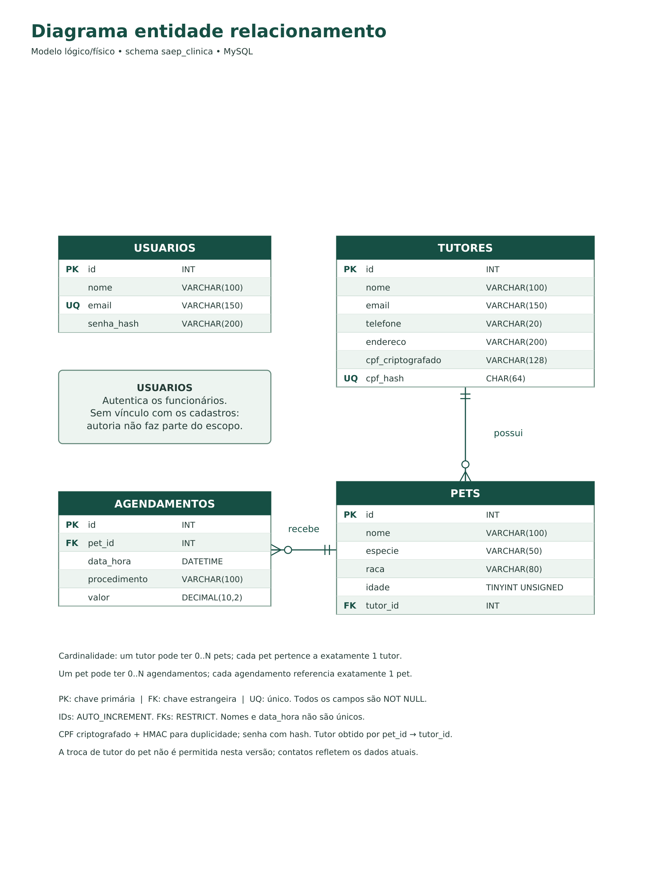

# Clínica veterinária — SAEP

Sistema de gerenciamento de tutores, pets e agendamentos.

Sistema feito com JavaScript, HTML, CSS, HTTP nativo do Node.js e MySQL.

## Funcionalidades

- Login com validação das credenciais, sessão de três horas e saída do sistema.
- Tela principal com nome do funcionário e navegação.
- Cadastro, listagem, busca e edição de tutores.
- CPF criptografado no banco e mascarado nas respostas da API.
- Cadastro, listagem e edição dos dados descritivos de pets, vinculados a um tutor.
- Cadastro, listagem cronológica e reagendamento de atendimentos, com os dados do tutor e do pet.

## Executar

Requisitos: Node.js 22 ou superior compatível, npm e MySQL Server 8.0.16 ou superior da série 8.0. O MySQL Workbench é a ferramenta cliente para executar o SQL e visualizar a modelagem.

1. Baixe ou clone este repositório e abra o terminal na pasta que contém `package.json`.
2. Instale as dependências:

   ```powershell
   npm ci
   Copy-Item .env.example .env.local
   ```

   No Linux/macOS, use `cp .env.example .env.local`.

3. Preencha `DB_USER`, `DB_PASSWORD`, host e porta em `.env.local`, conforme sua conexão do Workbench. Mantenha `DB_NAME=saep_db`.
4. No Workbench, execute **[banco/saep_db.sql](banco/saep_db.sql)** uma única vez em um schema novo/vazio. O script cria quatro tabelas e insere três registros em cada uma. Ele não migra nem remove o banco da loja.
5. Inicie o servidor:

   ```powershell
   npm start
   ```

6. Abra **http://localhost:3000/login**. Não abra os arquivos HTML por duplo clique.

Durante o desenvolvimento, `npm run dev` reinicia o servidor quando o código muda. O reinício encerra as sessões em memória. Iniciar a aplicação não cria nem popula o banco automaticamente.

### Login de demonstração

| Usuário | E-mail | Senha |
| --- | --- | --- |
| Ana Recepcao | ana@clinica.test | Clinica@123 |
| Bruno Recepcao | bruno@clinica.test | Clinica@123 |
| Carla Gestao | carla@clinica.test | Clinica@123 |

São contas fictícias de laboratório, com o mesmo acesso. Não existe cadastro público de usuários.

### Configuração da criptografia

O SQL de demonstração foi gerado com as chaves públicas de exemplo de `.env.example`. Mantenha essas chaves para abrir os dados fictícios desse SQL. Para usar outras chaves em um banco novo, gere dois valores diferentes de 32 bytes, atualize `CPF_KEY` e `CPF_HASH_KEY` em `.env.local` e execute `npm run gerar-sql` **antes** de instalar o banco.

```powershell
node --input-type=module -e "import {randomBytes} from 'node:crypto'; console.log(randomBytes(32).toString('hex'))"
```

Execute o comando duas vezes. As chaves precisam permanecer iguais às utilizadas na população do banco. Não troque as chaves de uma base já populada sem recriptografar os dados e recalcular o HMAC. As chaves públicas do exemplo e a senha de demonstração servem apenas ao exercício. `.env.local` não é versionado.

## Documentação e modelagem

- [Documentação do software — Anexo 1](docs/documentacao.md): requisitos funcionais e infraestrutura exigidos na atividade.
- [Modelagem e dicionário de dados](docs/modelagem.md): entidades, tipos, relacionamentos e instruções do Workbench.
- [Roteiro de validação](docs/validacao.md): verificações automáticas e testes com MySQL.
- [Descrição dos diagramas](docs/diagramas/README.md).

| Fluxograma | Casos de uso | DER |
| --- | --- | --- |
| [Abrir PNG](docs/diagramas/fluxograma.png) | [Abrir PNG](docs/diagramas/casos_de_uso.png) | [Abrir PNG](docs/diagramas/der.png) |

### Diagrama entidade relacionamento



## Organização

| Caminho | Responsabilidade |
| --- | --- |
| `server.js` | Recebe as requisições e encaminha páginas/API. |
| `banco/` | Estrutura, criação/população e gerador opcional de SQL. |
| `public/*.html` | Login, principal, tutores, pets e agendamentos. |
| `public/css/` | Estilo visual compartilhado. |
| `public/js/` | Eventos das páginas e funções separadas por recurso. |
| `servidor/funcoes/` | Operações da API. |
| `servidor/validacoes/` | Regras de entrada executadas no servidor. |
| `docs/` | Documentação Markdown e diagramas PNG. |
| `tests/` | Testes com o executor nativo do Node.js. |

O navegador nunca importa a conexão com o banco. As rotas de tutores, pets e agendamentos validam a sessão no servidor. Usuário do sistema é o funcionário; tutor é o responsável pelo animal.

## Verificar

```powershell
npm test
```

Os testes automáticos de regras e HTTP não precisam de MySQL e não alteram bancos existentes. A validação dos cadastros e do SQL com o MySQL do laboratório está descrita em [docs/validacao.md](docs/validacao.md).

## Escopo

Não há prontuário, faturamento, veterinários, permissões por perfil ou exclusão/cancelamento. O tutor do pet permanece o original na edição, e os contatos apresentados são os atuais. A agenda não bloqueia sobreposição de horários: a atividade não define profissional, sala ou capacidade de atendimento.
