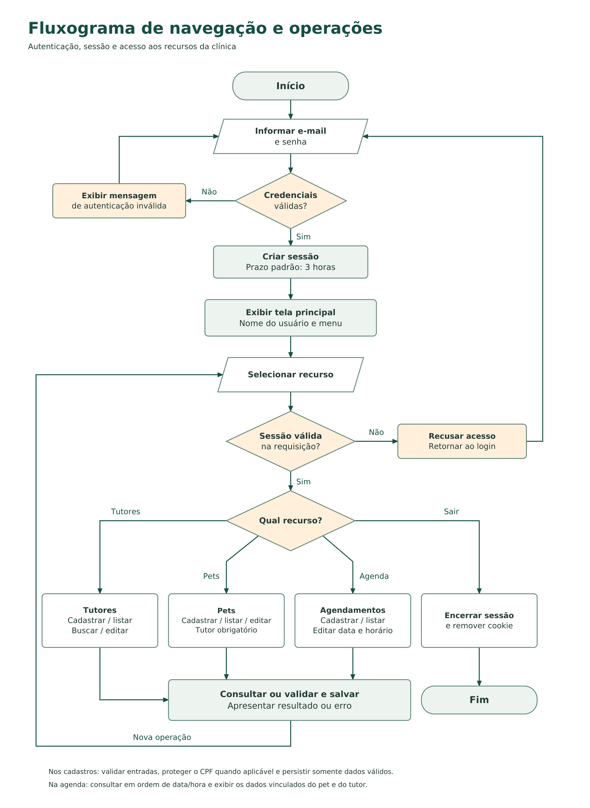
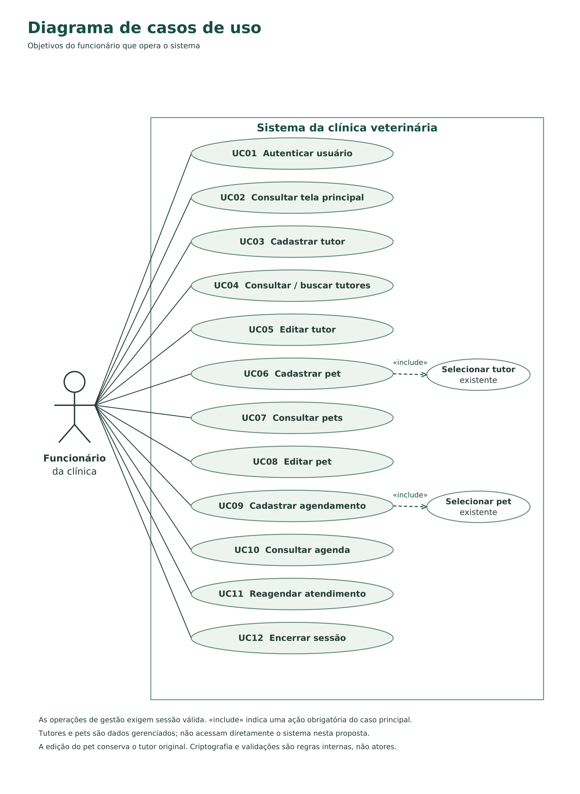
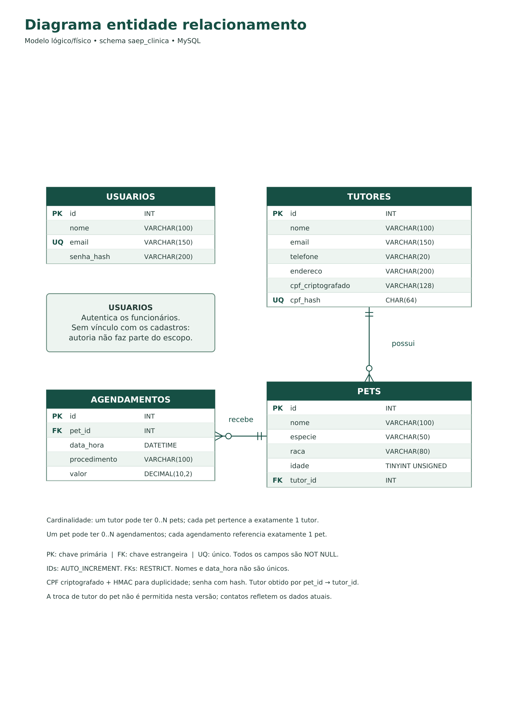

# Diagramas do sistema

Imagens PNG exportadas sem marca d'água, com base na clínica implementada neste repositório.

## Fluxograma

Representa a navegação geral: login, falha de autenticação, criação/expiração da sessão, acesso aos recursos e saída. A consulta e o preenchimento/gravação de formulários foram resumidos no bloco de operação.

## Casos de uso

O ator é o funcionário da clínica. Tutores e pets são dados gerenciados, sem acesso direto ao sistema.

| ID | Caso de uso |
| --- | --- |
| UC01 | Autenticar usuário. |
| UC02 | Consultar tela principal. |
| UC03 | Cadastrar tutor. |
| UC04 | Consultar / buscar tutores. |
| UC05 | Editar tutor. |
| UC06 | Cadastrar pet, incluindo a seleção de tutor existente. |
| UC07 | Consultar pets. |
| UC08 | Editar os dados descritivos do pet. |
| UC09 | Cadastrar agendamento, incluindo a seleção de pet existente. |
| UC10 | Consultar agenda. |
| UC11 | Reagendar atendimento. |
| UC12 | Encerrar sessão. |

A seta tracejada `«include»` aponta do caso principal para a ação obrigatoriamente incluída. As operações de gestão exigem uma sessão válida; o login é um objetivo independente, sem repetição obrigatória dentro de cada cadastro.

## Diagrama entidade relacionamento

Um tutor pode possuir zero ou vários pets; um pet pode receber zero ou vários agendamentos. Cada pet tem um tutor obrigatório e cada agendamento um pet obrigatório. usuarios autentica os funcionários e fica independente, pois esta versão não registra autoria dos cadastros.

Os atributos e restrições estão em [modelagem.md](../modelagem.md).
