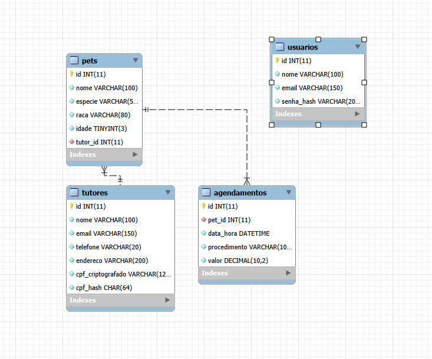

# Modelagem e dicionário de dados

**Schema:** `saep_clinica` — MySQL

## Entidades e cardinalidades

| Entidade | Finalidade | Relacionamento |
| --- | --- | --- |
| usuarios | Funcionários e autenticação | Independente dos cadastros; não há registro de autoria nesta versão. |
| tutores | Responsáveis pelos animais | Um tutor pode ter zero ou vários pets. |
| pets | Animais atendidos | Cada pet pertence a exatamente um tutor; pode ter zero ou vários agendamentos. |
| agendamentos | Atendimentos marcados | Cada agendamento referencia exatamente um pet. |

O tutor de um atendimento é obtido por `agendamentos.pet_id → pets.tutor_id → tutores.id`. Não há uma segunda FK de tutor em agendamentos, evitando combinar um animal com um responsável diferente. Na edição do pet, o tutor original é mantido. Os contatos apresentados são os atuais, sem fotografia histórica.

## Dicionário

Todos os campos são `NOT NULL`. PKs usam `AUTO_INCREMENT`; FKs têm o mesmo tipo `INT` das PKs referenciadas.

| Tabela.campo | Tipo | Regra |
| --- | --- | --- |
| usuarios.id | INT | PK. |
| usuarios.nome | VARCHAR(100) | Nome exibido; pode se repetir. |
| usuarios.email | VARCHAR(150) | UNIQUE, usado no login. |
| usuarios.senha_hash | VARCHAR(200) | Sal e hash scrypt separados por `:`. |
| tutores.id | INT | PK. |
| tutores.nome | VARCHAR(100) | Sem UNIQUE. |
| tutores.email | VARCHAR(150) | Contato; não é credencial; pode se repetir. |
| tutores.telefone | VARCHAR(20) | Texto para preservar a formatação. |
| tutores.endereco | VARCHAR(200) | Endereço em campo único. |
| tutores.cpf_criptografado | VARCHAR(128) |
| tutores.cpf_hash | CHAR(64) | HMAC-SHA-256, UNIQUE. |
| pets.id | INT | PK. |
| pets.nome | VARCHAR(100) | Sem UNIQUE. |
| pets.especie | VARCHAR(50) | Espécie do animal. |
| pets.raca | VARCHAR(80) | Raça ou Sem raça definida. |
| pets.idade | TINYINT UNSIGNED | Idade em anos inteiros, de 0 a 99. |
| pets.tutor_id | INT | FK para tutores.id. |
| agendamentos.id | INT | PK. |
| agendamentos.pet_id | INT | FK para pets.id. |
| agendamentos.data_hora | DATETIME | Data e horário locais da clínica. |
| agendamentos.procedimento | VARCHAR(100) | Descrição do atendimento. |
| agendamentos.valor | DECIMAL(10,2) | Valor não negativo. |

As FKs usam `ON DELETE RESTRICT` e `ON UPDATE RESTRICT`. O banco tem índice de busca para a data/hora, sem unicidade. O enunciado não define veterinário, sala, duração ou capacidade; não há bloqueio de horários simultâneos.

`DATETIME` guarda os componentes de dia e horário informados pelo formulário `datetime-local`, sem conversão automática de fuso. `DATE` perderia o horário. A idade é um valor informado e atualizado manualmente, escolhido para manter o exercício simples.

## Montar no MySQL Workbench

1. Abra sua conexão com o MySQL Server e confira `SELECT VERSION();`.
2. Abra `banco/saep_db.sql` e execute em um schema novo/vazio. Não execute repetidamente sobre tabelas já populadas.
3. Atualize Schemas e confirme três registros em cada uma das quatro tabelas.
4. Use Database > Reverse Engineer, selecione a conexão e o schema `saep_clinica`.
5. Coloque as quatro tabelas no EER Diagram, incluindo usuarios sem ligação.
6. Confira os vínculos tutor → pets e pet → agendamentos.
7. Salve o modelo como `clinica_veterinaria.mwb` e exporte como PNG.

Também é possível usar File > Import > Reverse Engineer MySQL Create Script com `banco/estrutura.sql`; essa opção importa a modelagem e não executa a população no servidor.

### Conferência das marcações

| Campo | Marcação |
| --- | --- |
| IDs | PK, NN e AI. |
| Demais campos | NN. |
| usuarios.email e tutores.cpf_hash | Índices UNIQUE. |
| Nomes e data_hora | Sem UQ. |
| FKs | INT, NN; relacionamentos não identificadores, de um para muitos. |

O SQL não altera o schema antigo da loja. O gerador `npm run gerar-sql` apenas reescreve o arquivo SQL local com os dados fictícios protegidos pelas chaves configuradas; não abre conexão nem executa o script no MySQL.
